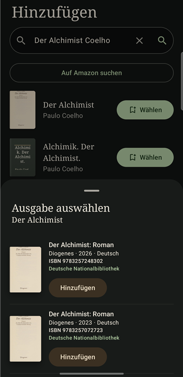
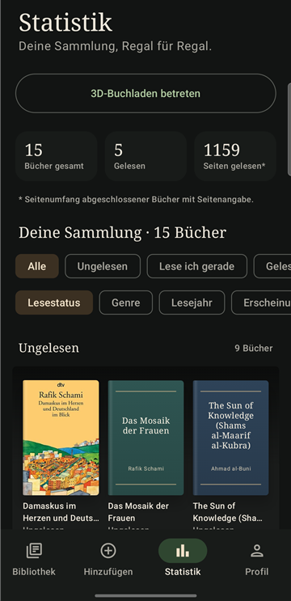
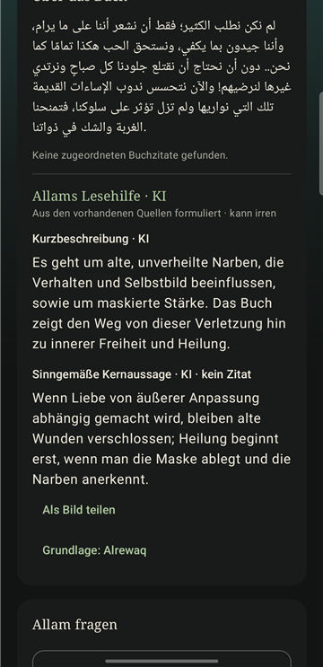

<div align="center">

# Warraq · الورّاق

**Deine persönliche Bibliothek fürs Handy: Deutsch und Arabisch, mit Kamera-Erkennung und einem begehbaren 3D-Buchladen im Stil eines alten syrischen Souks.**

[](https://github.com/momosadf58-web/Warraq/releases/latest)


[](LICENSE)






[English version below](#english)

</div>

---

## Worum geht es?

Warraq (arabisch *al-warrāq*, „der Buchhändler und Abschreiber“) ist eine App für alle, die ihre eigenen Bücher sammeln, ordnen und wiederfinden wollen. Besonders gilt das für Leute, die **deutsche und arabische Bücher** lesen. Viele Bibliotheks-Apps können mit arabischen Titeln, Autoren und Rechts-nach-links-Schrift kaum umgehen. Warraq behandelt beide Sprachen gleichwertig.

Die App braucht **kein Konto, kein Abo und keinen Server**. Deine Bibliothek bleibt auf deinem Handy.

## Was die App kann

- 📷 **Buch mit der Kamera erkennen.** Halte die Kamera auf ein Cover, und Titel und Autor werden direkt auf dem Gerät gelesen. Arabisch läuft über PaddleOCR und Tesseract, lateinische Schrift über ML Kit. Auch ISBN-Barcodes funktionieren.
- 🔎 **Werk suchen, dann die richtige Ausgabe wählen.** Ausgaben werden mit Cover, ISBN, Verlag und Jahr angezeigt. Quellen sind Open Library, die Deutsche Nationalbibliothek, Google Books, der arabische Verlag Alrewaq und ein eingebauter Katalog mit 1.745 Hindawi-Büchern.
- 📚 **Drei Lesestatus:** Ungelesen, Lese ich gerade, Gelesen. Dazu Lesejahr, Genre, Buchart und Notizen.
- 📊 **Statistik** über die ganze Sammlung: Genres, Lesejahre, Erscheinungsjahre, Romane und Sachbücher, gelesene Seiten.
- 🕌 **3D-Buchladen:** Du gehst durch enge Gänge mit dunklen Holzregalen. Deine gelesenen Bücher stehen dort mit echtem Cover, dazu wächst ein Stapel für dein Jahresziel. Der Raum läuft komplett offline (Three.js).
- 🎲 **Bücher-Orakel:** Es zieht zufällig ein ungelesenes Buch aus deinem Regal.
- 📖 **Buchwissen:** kurze Beschreibungen, belegte Zitate mit Quellenlink (Wikipedia und Wikiquote) und teilbare Bildkarten auf Deutsch und Arabisch.
- 🤖 **Optionale KI „Allam / علام“:** Lesetipps, Fragen an die eigene Bibliothek, Jahresrückblick und eine Lesehilfe mit Kurzbeschreibung. Dafür brauchst du einen **eigenen** Ollama-Cloud-Schlüssel, den du in der App einträgst. Ohne Schlüssel funktioniert alles andere ganz normal. KI-Texte sind immer als „KI“ markiert, die KI erfindet keine Zitate und ändert keine Buchdaten.
- 💾 **Sicherung und Wiederherstellung** als ZIP. Vor jeder Wiederherstellung legt die App automatisch einen Rückfallstand an.

## Herunterladen und installieren

1. Öffne die [neueste Version unter Releases](https://github.com/momosadf58-web/Warraq/releases/latest) und lade `Warraq-…apk` herunter.
2. Öffne die Datei auf dem Handy. Android fragt einmal, ob du Apps aus dieser Quelle erlauben willst; erlaube das für deinen Browser oder Dateimanager.
3. Fertig. Voraussetzung ist Android 8.0 oder neuer. Kamera und Internet werden nur für Erkennung und Buchsuche benötigt.

> Die App ist nicht im Play Store. Die Prüfsumme (SHA-256) jeder APK steht in den Release-Notizen.

## Selbst bauen

Voraussetzungen: JDK 17 und das Android SDK (API 35). Am einfachsten geht das mit Android Studio.

```bash
git clone https://github.com/momosadf58-web/Warraq.git
cd Warraq/Code/Android
./gradlew assembleDebug        # Windows: gradlew.bat assembleDebug
./gradlew testDebugUnitTest    # Unit-Tests
```

Die fertige APK liegt danach unter `app/build/outputs/apk/debug/`. Für eine Release-Version brauchst du einen eigenen Signierschlüssel. Er gehört **nicht** ins Repository.

## Projektstruktur

```
Code/Android/app/src/main/
├── java/de/mo/bibliothek/
│   ├── MainActivity.kt, BookieViewModel.kt   Navigation und Zustand
│   ├── data/   Buchmodell, Speicherung, Kataloge (Open Library, DNB, Google Books, Alrewaq, Hindawi),
│   │           Texterkennung, Coververgleich, Buchwissen, Statistik, optionale KI
│   └── ui/     Bildschirme (Bibliothek, Hinzufügen, Kamera, Details, Statistik, 3D-Raum, Profil)
└── assets/
    ├── room/       3D-Buchladen (HTML/JS, Three.js)
    ├── tessdata/   Tesseract-Modelle (Arabisch, Deutsch, Englisch)
    ├── paddle/     PaddleOCR-Modelle für Arabisch (ONNX)
    └── hindawi-*.json   Offener Metadaten-Katalog arabischer Bücher
```

## Datenschutz

- Keine Anmeldung, keine Werbung, kein Tracking.
- Die Bibliothek wird nur lokal gespeichert (`library.json` und Coverbilder).
- Bei einer Buchsuche schickt die App den Suchbegriff an die oben genannten Kataloge.
- Die KI ist ausgeschaltet, bis du selbst einen Schlüssel einträgst. Der Schlüssel liegt im geschützten App-Speicher und landet nie in Sicherungen.

## Lizenz

**Kostenlos für private, nicht-kommerzielle Nutzung.** Du darfst die App nutzen, den Code lesen, verändern und weitergeben, solange es nicht kommerziell ist. **Firmen dürfen Warraq nicht kommerziell verwenden.**

- Eigener Code: [PolyForm Noncommercial 1.0.0](LICENSE)
- Eigene Texte, Grafiken und App-Symbol: [CC BY-NC 4.0](https://creativecommons.org/licenses/by-nc/4.0/deed.de)
- Fremde Bibliotheken, Modelle, Schriften und Daten behalten ihre eigenen Lizenzen. Siehe [THIRD_PARTY.md](THIRD_PARTY.md).

Hinweis: Wegen der Einschränkung auf nicht-kommerzielle Nutzung ist Warraq „source-available“ und keine Open-Source-Software im Sinne der OSI.

## Mitmachen

Fehler und Ideen sind als [Issue](https://github.com/momosadf58-web/Warraq/issues) willkommen, gern auf Deutsch, Arabisch oder Englisch.

---

<a id="english"></a>

## English

**Warraq (الورّاق)** is a personal library app for Android that treats **German and Arabic books equally**, including right-to-left layout, Arabic text recognition and Arabic catalogues. It needs no account, no subscription and no server, and your library stays on your phone.

**Features:** camera recognition of title and author from a cover (on-device OCR: PaddleOCR and Tesseract for Arabic, ML Kit for Latin script) and ISBN barcodes · search a work, then pick the exact edition (Open Library, German National Library, Google Books, Alrewaq, built-in Hindawi catalogue) · three reading states, statistics · an offline 3D bookshop styled after an old Syrian souk, showing your finished books with real covers and a yearly goal stack · random "book oracle" · short descriptions, sourced quotes and shareable image cards · optional AI helper "Allam" using **your own** Ollama Cloud key (clearly labelled, never invents quotes or changes book data) · ZIP backup and restore.

**Download:** grab the latest `Warraq-…apk` from [Releases](https://github.com/momosadf58-web/Warraq/releases/latest) (Android 8.0+), then allow installing from that source when Android asks.

**Build:** JDK 17 and Android SDK 35, then `cd Code/Android && ./gradlew assembleDebug`.

**License:** free for personal, non-commercial use under [PolyForm Noncommercial 1.0.0](LICENSE) (code) and CC BY-NC 4.0 (own artwork and texts). Commercial use by companies is not permitted. Third-party components keep their own licenses, see [THIRD_PARTY.md](THIRD_PARTY.md).
