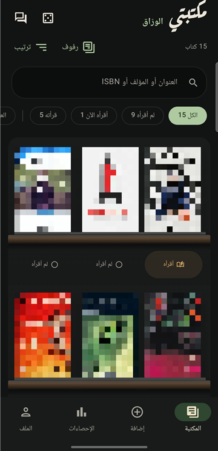

# Warraq · الورّاق

Warraq ist eine Android-App für die eigene Büchersammlung, gebaut für Leute, die deutsche und arabische Bücher lesen. Man fotografiert ein Cover, wählt die passende Ausgabe aus und hat das Buch im Regal. Gelesene Bücher stehen zusätzlich in einem kleinen 3D-Buchladen, der einem alten syrischen Souk nachempfunden ist.

<p>



</p>

**[APK herunterladen](https://github.com/momosadf58-web/Warraq/releases/latest)** · Android 8.0 oder neuer · [English below](#english)

## Warum es die App gibt

Die meisten Bibliotheks-Apps finden arabische Titel schlecht, verwechseln Ausgaben oder kommen mit Schrift von rechts nach links nicht zurecht. Warraq ist von Anfang an zweisprachig gebaut. Die Oberfläche gibt es auf Deutsch und Arabisch, die Texterkennung liest arabische Cover direkt auf dem Gerät, und für arabische Bücher sucht die App zusätzlich im Katalog der Hindawi-Stiftung und beim Verlag Alrewaq.

Ein Konto braucht man nicht. Die Bibliothek liegt als `library.json` mit den Coverbildern auf dem Handy und lässt sich als ZIP sichern.

## Funktionen

Bücher hinzufügen geht per Kamera, ISBN-Barcode oder Titelsuche. Die App zeigt zuerst das Werk und danach alle gefundenen Ausgaben mit Cover, ISBN, Verlag und Jahr, damit man genau die eigene Ausgabe erwischt. Gesucht wird bei Open Library, der Deutschen Nationalbibliothek, Google Books, Alrewaq und in einem eingebauten Katalog mit 1.745 Hindawi-Titeln.

Jedes Buch hat einen von drei Status: ungelesen, lese ich gerade, gelesen. Die Statistik zählt Bücher und gelesene Seiten und gruppiert nach Genre, Lesejahr, Erscheinungsjahr und Roman oder Sachbuch. Fehlende Angaben zeigt sie als fehlend an und rät nicht.

Im 3D-Buchladen stehen die gelesenen Bücher mit ihrem echten Cover zwischen anonymen Kulissenbänden. Ein Stapel zeigt, wie weit man beim Jahresziel ist. Der Raum läuft mit Three.js komplett offline. Das Bücher-Orakel zieht ein zufälliges ungelesenes Buch aus dem Regal.

In den Buchdetails stehen eine kurze Beschreibung und, wenn vorhanden, Zitate aus Wikiquote mit Link zur Quelle. Beides lässt sich als Bildkarte teilen.

Optional gibt es den KI-Helfer Allam (علام). Er macht Lesetipps, beantwortet Fragen zur eigenen Sammlung und schreibt eine Kurzbeschreibung aus den vorhandenen Quellen. Dafür trägt man einen eigenen Ollama-Cloud-Schlüssel in der App ein. Ohne Schlüssel bleibt Allam aus und der Rest funktioniert normal. Was Allam schreibt, ist als KI-Text markiert. Er erfindet keine Zitate und ändert keine Buchdaten.

## Installieren

1. Unter [Releases](https://github.com/momosadf58-web/Warraq/releases/latest) die Datei `Warraq-3.4.7.apk` laden.
2. Die Datei auf dem Handy öffnen. Android fragt einmal nach der Erlaubnis, Apps aus dieser Quelle zu installieren.
3. Die App fragt beim ersten Scannen nach der Kamera. Internet braucht sie nur für die Buchsuche.

Warraq ist nicht im Play Store. Die SHA-256-Prüfsumme der APK steht in den Release-Notizen.

## Selbst bauen

Nötig sind JDK 17 und das Android SDK mit API 35, am einfachsten über Android Studio.

```bash
git clone https://github.com/momosadf58-web/Warraq.git
cd Warraq/Code/Android
./gradlew assembleDebug          # unter Windows: gradlew.bat assembleDebug
./gradlew testDebugUnitTest
```

Die APK liegt danach in `app/build/outputs/apk/debug/`. Für eine signierte Release-Version braucht man einen eigenen Schlüssel, der nicht ins Repository gehört.

## Aufbau des Codes

```
Code/Android/app/src/main/
  java/de/mo/bibliothek/
    MainActivity.kt, BookieViewModel.kt   Navigation und Zustand
    data/   Buchmodell, Speicherung, Kataloge, Texterkennung, Coververgleich,
            Buchwissen, Statistik, KI-Anbindung
    ui/     Bildschirme: Bibliothek, Hinzufügen, Kamera, Details, Statistik, 3D-Raum, Profil
  assets/
    room/        3D-Buchladen (HTML, JavaScript, Three.js)
    tessdata/    Tesseract-Modelle für Arabisch, Deutsch, Englisch
    paddle/      PaddleOCR-Modelle für Arabisch (ONNX)
    hindawi-*.json   Metadaten und Beschreibungen arabischer Bücher
```

Arabische Cover liest die App mit PaddleOCR und Tesseract als Rückfall, lateinische Schrift mit Google ML Kit. Alles läuft auf dem Gerät.

## Daten und Privatsphäre

Es gibt keine Anmeldung, keine Werbung und kein Tracking. Bei einer Suche geht nur der Suchbegriff an die genannten Kataloge. Der KI-Schlüssel liegt im geschützten App-Speicher und wird nicht mitgesichert.

## Lizenz

Warraq darf privat und nicht-kommerziell frei genutzt, verändert und weitergegeben werden. Kommerzielle Nutzung durch Firmen ist nicht erlaubt.

Der Code steht unter der [PolyForm Noncommercial License 1.0.0](LICENSE), eigene Texte, Grafiken und das App-Symbol unter [CC BY-NC 4.0](https://creativecommons.org/licenses/by-nc/4.0/deed.de). Fremde Bibliotheken, Modelle, Schriften und Daten behalten ihre eigenen Lizenzen, die Liste steht in [THIRD_PARTY.md](THIRD_PARTY.md). Wegen der Beschränkung auf nicht-kommerzielle Nutzung ist das Projekt im Sinne der OSI kein Open Source, der Quellcode ist aber vollständig offen einsehbar.

Fehler und Vorschläge bitte als [Issue](https://github.com/momosadf58-web/Warraq/issues), auf Deutsch, Arabisch oder Englisch.

<a id="english"></a>

## English

Warraq is an Android app for your own book collection, built for people who read in German and Arabic. Point the camera at a cover, pick the exact edition and the book is on your shelf. Arabic is handled properly: right-to-left layout, on-device recognition of Arabic covers (PaddleOCR, Tesseract) and extra catalogues for Arabic books (Hindawi, Alrewaq) next to Open Library, the German National Library and Google Books.

There are three reading states, statistics, a random pick from your unread books and an offline 3D bookshop modelled on an old Syrian souk where your finished books stand with their real covers. An optional assistant called Allam gives reading tips and short summaries if you enter your own Ollama Cloud key. No account and no tracking. Your library stays on the phone.

Download the APK from [Releases](https://github.com/momosadf58-web/Warraq/releases/latest) (Android 8.0+), or build it with JDK 17 and SDK 35: `cd Code/Android && ./gradlew assembleDebug`.

Free for personal, non-commercial use under the [PolyForm Noncommercial License 1.0.0](LICENSE). Own artwork and texts are CC BY-NC 4.0. Commercial use by companies is not allowed. Third-party parts keep their own licenses, see [THIRD_PARTY.md](THIRD_PARTY.md).
